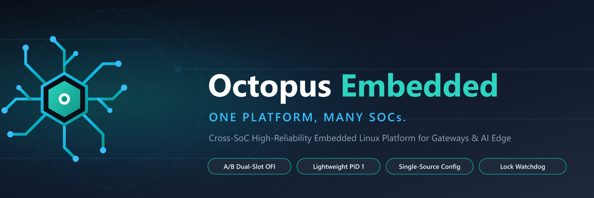
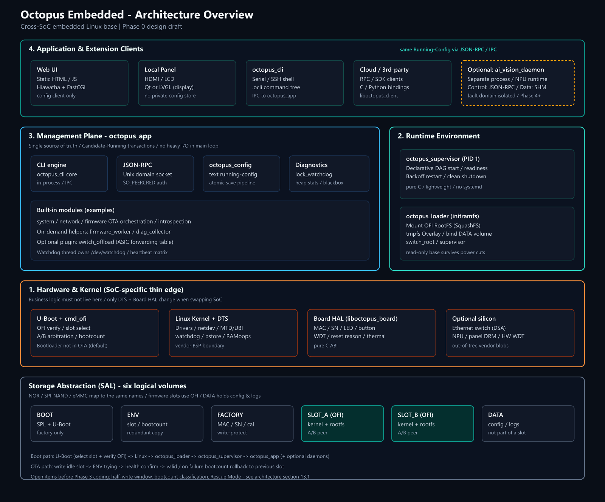

<p align="center">
  
</p>

<p align="center">
  <strong>English</strong> | <a href="README.zh-CN.md">简体中文</a>
</p>

<p align="center">
  <a href="LICENSE"></a>
  
  
  <a href="docs/README.md"></a>
</p>

# Octopus Embedded

> Cross-SoC embedded Linux software base for industrial gateways, always-on field devices, and edge vision products.

Octopus Embedded is an open-source design starting point (docs now, code from Phase 1) for devices that must run unattended for long periods. Initial targets include Rockchip RK3568, SigmaStar SSD20X, and Allwinner; the architecture is written to extend to similar ARM application processors. Focus areas: rollback-capable firmware updates, process supervision, a single management plane, storage abstraction, and clear module boundaries.

Phase 0 publishes an architecture draft and RFCs. Implementation starts in Phase 1 — see [ROADMAP.md](ROADMAP.md).

Simplified Chinese (`README.zh-CN.md` and `docs/`) is authoritative; this English README tracks that text. Detailed specs under `docs/` are Chinese-first for now.

### Architecture overview

One-page view of layers and logical volumes. Source SVG: [`assets/architecture-overview.svg`](assets/architecture-overview.svg).

<p align="center">
  
</p>

Top to bottom: clients (Web / panel / CLI / cloud, plus optional vision) → management plane `octopus_app` → runtime (`octopus_loader` + `octopus_supervisor`) → kernel and thin Board HAL. The six volumes at the bottom are the media-agnostic storage model; firmware slots use OFI and stay separate from `DATA`.

---

## Why Octopus Embedded?

These problems show up repeatedly when shipping embedded Linux products. The third column is what this project intends to do (design stage — not all of it is code yet).

Terms such as firmware slot / dual slot / A/B arbitration / OFI appear below: roughly, two bootable images on Flash, upgrade writes the idle one, failed boot rolls back; OFI is the unified package format. Diagrams are in [Key terms](#key-terms).

| Common problem | What happens | Intended approach here |
|:---|:---|:---|
| SoC SDK owns the whole lifecycle | Changing SoC (e.g. RK3568 → SSD20X) often means rewriting flashers, packages, and slot-selection boot scripts | Unified OFI format and dual-slot state machine; keep SoC differences in DTS and a thin Board HAL |
| Flash media swap breaks OTA | NOR / SPI-NAND / eMMC changes expose bad-block and MTD vs block-device mismatches | Storage Abstraction Layer (SAL): six logical volumes; UBI for slots on SPI-NAND; filesystem chosen per media for DATA |
| CLI / Web / cloud / local UI each keep a copy | Serial edits invisible on the panel; panel save overwrites cloud; power cut truncates the config file | One Candidate–Running config shared by all clients; conflict detection and confirmed commit; text config + atomic save |
| PID 1 extremes: systemd heavy, BusyBox thin | Small gateways struggle with systemd; BusyBox lacks dependency order, readiness, backoff | Lightweight `octopus_supervisor` (pure C, small footprint, DAG start + backoff restart) |
| Field crash leaves no evidence | Watchdog reset clears logs; Flash cannot hold core dumps; leaks and deadlocks stay opaque | Lock monitor, per-module heap stats, debug overrun guards, crash stacks to RAMoops/Flash |
| Power-cut destroys a writable root | Metadata damage → unmountable root → return to factory | Read-only SquashFS + Overlay; persistent data kept off the root |
| Motion control and NPU in one process | Vendor NPU user-space fault takes down the box; HD frames over sockets burn CPU on copies | JSON-RPC control plane; image/tensor over shared memory; vision in a separate process under supervisor |
| Dropping in SWUpdate / RAUC still leaves a gap | Frameworks assume Bootloader already selects slots and handles bad blocks; they do not own config migration or process lifecycle | Slot selection and bad-block semantics in both U-Boot and user space; upgrade, config, and supervision on one base |

---

## Supported scenarios

- Industrial or always-on gateways: routing, dual-slot OTA, field diagnostics
- Devices with a local panel: panel, Web, CLI, and cloud share one config
- Edge vision / robotics-style products: main process separate from an optional NPU vision process
- Multi-SoC product lines: shared lifecycle rules; toolchain varies by board

---

## Key terms

Four terms recur in the architecture docs. They describe one idea: how the system image sits on Flash, and which copy boots after power-on or upgrade.

### Figure 1: Flash layout

```text
  +---------------+  +---------------------+ +---------------------+
  |  1. BOOT      |  |  4. SLOT_A          | |  5. SLOT_B          |
  |  SPL + U-Boot |  |  firmware slot A    | |  firmware slot B    |
  +---------------+  +---------------------+ +---------------------+
                     |  kernel + rootfs    | |  kernel + rootfs    |
                     +---------------------+ +---------------------+

  +---------------+  +---------------------------------+
  |  2. ENV       |  |  6. DATA                        |
  |  boot_slot    |  |  user config + logs             |
  |  slot states  |  +---------------------------------+
  |  bootcount    |  +-----------------+
  +---------------+  |  3. FACTORY     |
                     |  MAC / SN       |
                     +-----------------+
```

| Block | Role | Remote upgrade? |
|:---|:---|:---|
| `1. BOOT` | SPL + U-Boot, factory-flashed once | No |
| `2. ENV` | Boot parameters (redundant): active slot, slot state, consecutive boot failures | Read/write during upgrade |
| `3. FACTORY` | MAC, serial, factory calibration; preferably write-protected | No |
| `4. SLOT_A` / `5. SLOT_B` | One full bootable system each (kernel + rootfs) in OFI format | Write the idle slot |
| `6. DATA` | Config and logs; not part of either slot | Not overwritten by upgrade; factory reset mainly clears this |

`4`/`5` are two images of the same format; `1`–`3` are the boot chain; `6` is independent of firmware version. Diagrams use ASCII boxes only.

### Figure 2: Dual-slot upgrade and rollback

```text
  normal operation
  +--------------------------+   +--------------------------+
  |  SLOT_A                  |   |  SLOT_B                  |
  |  system image 1          |   |  system image 2          |
  |  [ RUNNING ]             |   |  [ STANDBY ]             |
  +--------------------------+   +--------------------------+
               |
               |  OTA: write new image into the slot that is NOT running
               v
  first boot after OTA
  +--------------------------+   +--------------------------+
  |  SLOT_A                  |   |  SLOT_B                  |
  |  old version             |   |  new version             |
  |  [ still bootable ]      |   |  [ TRYING ]              |
  +--------------------------+   +--------------------------+
               |                              |
        boot / self-check ok             boot / self-check fail
               v                              v
     mark B VALID, next boot B         bootloader returns to A
```

`RUNNING` = active; `STANDBY` = idle; `TRYING` = provisional. Which slot boots next is stored in `ENV`.

| Term | Meaning |
|:---|:---|
| Firmware slot | `SLOT_A` or `SLOT_B`: region holding one full bootable system |
| Dual slot | Two peer slots, only one runs; upgrade writes the idle slot; failure returns to the old slot |
| A/B arbitration | Choose A or B from `ENV` slot state and boot-failure count. Vendor SDKs often ship chip-specific scripts; this project uses one state machine |
| OFI | Octopus Firmware Image (`.ofi`): unified sectioned package (header, signature, kernel/rootfs/optional model) |

Easy mix-ups:

1. “Slot” means system firmware only, not `DATA`. Config and logs live in `DATA` and are not overwritten by a slot switch by default. On read-only root + Overlay builds, persist under `/data`; writes under `/etc` are lost on reboot.
2. Dual slot is not two systems running at once; the idle slot is a bootable standby.

Some state-machine items are still open (half-write window, rescue mode, etc.) — see architecture [§13.1](docs/architecture/00-platform-design.md#131-phase-3-编码前-blockers必须定稿).

---

## Documentation

Start at [docs/README.md](docs/README.md). Every Chinese design doc has an English twin (`*.en.md`). **Simplified Chinese remains authoritative** for architecture intent when the two diverge.

| Area | Chinese | English | Notes |
|------|---------|---------|-------|
| Core architecture | [00-platform-design.md](docs/architecture/00-platform-design.md) | [`.en.md`](docs/architecture/00-platform-design.en.md) | Layers, HAL, RFCs |
| Reliability | [00-critical-topics.md](docs/reliability/00-critical-topics.md) | [`.en.md`](docs/reliability/00-critical-topics.en.md) | Watchdog, OOM, storage, diagnostics |
| Language | [00-language-cpp-guidelines.md](docs/guides/00-language-cpp-guidelines.md) | [`.en.md`](docs/guides/00-language-cpp-guidelines.en.md) | C / C++ boundaries |
| Testing | [01-qemu-test-strategy.md](docs/guides/01-qemu-test-strategy.md) | [`.en.md`](docs/guides/01-qemu-test-strategy.en.md) | x86 / QEMU / power-cut |
| Switch / drivers | [02-switch-hal-drivers.md](docs/guides/02-switch-hal-drivers.md) | [`.en.md`](docs/guides/02-switch-hal-drivers.en.md) | HAL / optional offload |
| Vision / robotics (later) | [03-ai-robot-vision.md](docs/guides/03-ai-robot-vision.md) | [`.en.md`](docs/guides/03-ai-robot-vision.en.md) | Not on Phase 1–3 critical path |
| Brand | [branding.md](docs/project/branding.md) | (bilingual in one file) | Naming and logo |

---

## Roadmap

See [ROADMAP.md](ROADMAP.md).

| Phase | Focus | Tag | Status |
|-------|--------|-----|--------|
| 0 | Architecture draft and RFCs (this repo’s docs) | `v0.1.0-design` | Published, open for discussion |
| 1 | `liboctopus_basics`, CMake, unit tests, parser fuzz, JSON-RPC stub | `v0.2.0-alpha` | Planned |
| 2 | CLI, config transactions, Board HAL, public SDK | `v0.3.0-alpha` | Planned |
| 3 | U-Boot OFI, supervisor, dual-slot firmware | `v0.4.0-beta` | Planned |
| 4 | Integration, optional vision, stress tests | `v1.0.0-rc1` | Planned |

---

## Contributing

RFCs, doc fixes, and issues are welcome in the design phase. Read [CONTRIBUTING.md](CONTRIBUTING.md) first.

Architecture intent is authoritative in Simplified Chinese (`README.zh-CN.md` and `docs/`). Phase-3 coding blockers: [§13.1](docs/architecture/00-platform-design.md#131-phase-3-编码前-blockers必须定稿).

---

## Security

See [SECURITY.md](SECURITY.md). Do not paste exploit details into public issues.

---

## License

[Apache License 2.0](LICENSE).

---

## Disclaimer

Octopus Embedded is an independent open-source project and is not affiliated with [Octopus Deploy](https://octopus.com) or other holders of the “Octopus” mark. This repository currently holds original architecture documentation only; it does not include or distribute third-party proprietary/closed-source code or prebuilt binaries. Mentions of vendor SDKs, NPU runtimes, or boot firmware are integration-boundary notes only and must be obtained under the vendor’s own license. This is an architecture draft; critical A/B and rescue items remain open (architecture chapter 13) and are not a claim of mass-production validation.
